<div align="center">

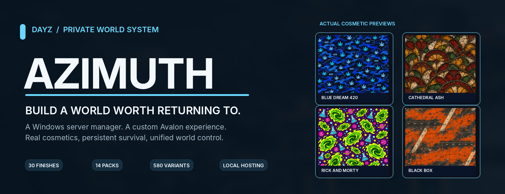

<strong>A self-hosted DayZ world, a custom Avalon experience, and the tools to make it personal.</strong>

<strong>Windows 10/11 · DayZ PC · Local hosting · Avalon · 30 finishes · 14 additional vehicle packs</strong>

<br/>

<strong>R23 · Latest Workshop-backed economy qualification: 14 November 2026</strong>

<a href="#the-30-finish-atlas">Explore finishes</a> · <a href="#land-sea-and-air-transport">Explore transport</a> · <a href="#avalon-workshop-loot-economy-verification">Loot economy</a> · <a href="#getting-started">Getting started</a> · <a href="#verification-and-known-limits">Verification</a>

</div>

> **Why I built Azimuth:** I wanted to play DayZ in my own private world, customize how it looked and played, and manage everything without constantly fighting with server files, mods, and launchers. So I built one place to do it.

Azimuth is a **Windows desktop server manager and DayZ integration project** built around **Avalon**. Instead of treating the server, Workshop requirements, graphics settings, cosmetics, transport and saves as disconnected jobs, it brings them into a single organized workflow. The result is a persistent private world where base-building, exploration, collection and experimentation can happen on the host PC's own terms.

**Created by Ashton Kenney · Astroolean.** Azimuth's original integration, tools and cosmetic systems are distinct from DayZ, Avalon and the third-party Workshop mods it uses.

**Complete combined release:** The Windows manager, source files, launcher, GitHub gallery, audit reports and current Avalon economy repair are together in this archive. Extract `Azimuth/` once; do not install a separate documentation ZIP. Existing game worlds and backups must be retained when updating.

<details>
<summary><strong>Jump to a section</strong></summary>

- [What Azimuth is](#what-azimuth-is)
- [The application and launch flow](#the-application-and-launch-flow)
- [The eight-page control panel](#the-eight-page-control-panel)
- [Survival, building and atmosphere](#survival-building-and-atmosphere)
- [Avalon Workshop loot economy verification](#avalon-workshop-loot-economy-verification)
- [How the cosmetic system works](#how-the-cosmetic-system-works)
- [The 30-finish atlas](#the-30-finish-atlas)
- [Vehicle-wrap coverage and limits](#vehicle-wrap-coverage-and-limits)
- [Land, sea and air transport](#land-sea-and-air-transport)
- [Inspection, photo mode and showcases](#inspection-photo-mode-and-showcases)
- [Graphics and personal preferences](#graphics-and-personal-preferences)
- [Persistence, backups and recovery](#persistence-backups-and-recovery)
- [Requirements and installation](#requirements-and-installation)
- [Getting started](#getting-started)
- [File layout](#file-layout)
- [Verification and known limits](#verification-and-known-limits)
- [Credits, dependencies and ownership](#credits-dependencies-and-ownership)

</details>

---

## What Azimuth is

Azimuth has **three connected parts**: a desktop management application, a prepared Avalon world configuration, and a set of custom DayZ systems. Its purpose is to make a heavily modded private world easier to operate without turning the survival experience into a completely different game.

| Part | Role in the experience | Examples |
|:---|:---|:---|
| **Azimuth desktop manager** | Coordinates the server, client, supported Workshop downloads, launch preparation and diagnostics. | Start/stop, status, preferences, Workshop readiness, backups and event logs. |
| **Avalon world integration** | Applies local survival, economy, building, transport and quality-of-life configurations. | Starter kit, loot balancing, vehicles, fishing, base-building and optional comfort rules. |
| **Custom cosmetic and creative addons** | Adds an original 30-finish collection and tools to inspect, preview and showcase compatible equipment. | Random weapon and gear finishes, vehicle wraps, weapon inspection, photo mode and optional one-time vehicle deliveries. |

The server runs **locally on the host Windows PC**; that PC supplies the CPU, memory, disk space and uptime. Local/LAN access is part of the manager. Internet access for remote players depends on the network and port configuration. **Console server hosting is not provided by this project.**

### At a glance

| Included in the R23 package | Detail |
|:---|:---|
| **30 cosmetic finishes** | 6 original blue/space/420 finishes, 14 survival-original designs, 10 adult-animation-inspired designs. |
| **60 fixed rifle variants** | Dedicated M4A1 and AKM classes for 30 finishes each, alongside random finish support on compatible ordinary equipment. |
| **14 additional transport packs** | 580 configured body, color and vehicle variants, supplemental to other transport integrations. |
| **738 audited public vehicle variants** | Coverage inventory; this is not a count of vehicles that will spawn simultaneously. |
| **8 manager pages** | Overview, Worlds, Workshop, Skins / Camos, Backups, Activity, Client and Settings. |
| **5,310 effective economy classes** | Includes 1,679 ordinary-loot classes in the reproduced Avalon mission; source-audited offline, not an in-game spawn guarantee. |
| **49 Workshop evidence archives** | 76 installed mod folders and 391 PBOs inspected for the latest qualification. |
| **Persistent data handling** | World profiles, saves, cosmetic preferences, delivery receipts and safe restore workflow. |


## The application and launch flow

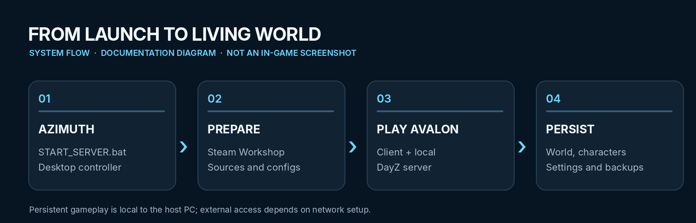

The goal is a predictable **Play Avalon** workflow. Azimuth checks the relevant DayZ client/server installation, prepares world and custom mod configurations, accounts for supported dependencies, and coordinates the local server and game launch. Generated custom addons use the existing Windows build/signing workflow and require DayZ Tools when regeneration is needed.

**Before joining**, Azimuth can detect mismatched game/server builds, missing installed Workshop requirements and changes that need a configuration refresh. It also prevents a previously used vehicle pack from silently vanishing from a saved world: missing required classes are surfaced instead of loading without them and risking persistence loss.

**During first-run world setup**, Avalon may perform a bounded survey for suitable large-vessel and aircraft placement locations. Play Avalon can spend up to two minutes waiting for that survey and may do one clean setup restart if verified results or initial fishing configuration need importing. The survey checks places; it does **not** create a fleet of vehicles, guarantee placements, or spawn objects at unsafe fallback locations.

**When something fails**, the manager reports startup and readiness information and pauses repeated automatic restarts. It does not endlessly launch a failing server. A running healthy server is not intentionally stopped merely because the client failed to open.

**World continuity matters:** the launch process is designed to work with existing saves, already-owned vehicles, selected skins and one-time showcase receipts. A software update should not require starting a new character or erasing a base.


## The eight-page control panel

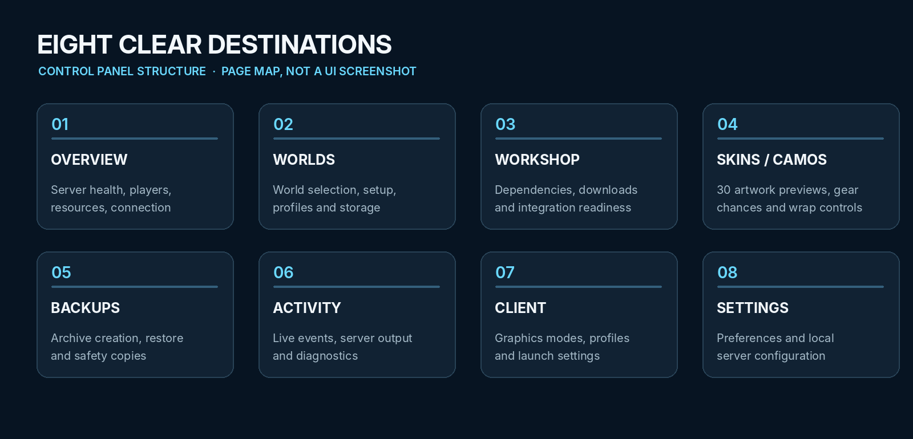

The interface separates tasks by purpose so that everyday decisions are not hidden inside an installation folder. The visualization is a **navigation diagram**, not a fabricated screenshot of the running Windows UI.

| Page | What's inside | Why it matters |
|:---|:---|:---|
| **Overview** | Server state, uptime, online player count, CPU, memory and local/LAN connection details. | Essential status without searching through logs. |
| **Worlds** | Select the world, inspect preparation status and access world-specific setup or files. | Keeps different save contexts organized. |
| **Workshop** | View known required mods, dependencies, download/readiness state and supported integration details. | Steam-managed content remains recognizable and traceable. |
| **Skins / Camos** | Preview 30 finishes, enable selections, control weapon/gear and vehicle percentages, and manage optional test/showcase items. | Makes cosmetic choices explicit and repeatable. |
| **Backups** | Create archives, inspect stored backups and restore a selected world safely. | Protects hours of survival and base-building progress. |
| **Activity** | Review application operations, server output and troubleshooting notices. | Explains what was attempted and where preparation stopped. |
| **Client** | Set graphics presets, select a DayZ profile and review client-oriented launch options. | Keeps visual or performance changes reversible. |
| **Settings** | Save manager and server preferences. | Avoids editing unrelated application code for routine changes. |

### Workshop responsibility

Azimuth uses **original third-party Workshop downloads** and their declared dependencies. The manager coordinates supported content but does not transfer ownership, rewrite every external PBO, replace a required creator's published files or make an absent mod magically available. Mod compatibility depends on the installed versions and actual author-defined class names.


## Survival, building and atmosphere

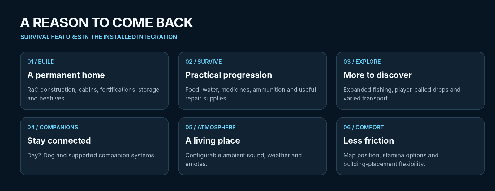

Avalon's survival adjustments are intended to make a private, persistent game more practical, **not** to hand out rare equipment everywhere or remove progression. Settings still work within DayZ's central economy, building tags, spawn locations, regional tiers and active event rules.

### Loot and progression

| Area | R23 behavior |
|:---|:---|
| Loose, ordinary ammunition | Configured quantity range of **50–100%**. |
| Standard magazines | Configured quantity range of **35–100%**. |
| Everyday supplies | Bounded improvements for common food, water containers, medicine, tools and repair ingredients. |
| Base and vehicle maintenance | Practical loot routes for nails, locks, vehicle spares and other widely useful parts. |
| Normal spare magazines | Ordinary loot routes are included for the audited standard-spawning weapon selection. |
| Protected rare gear | Rare weapons, high-capacity magazines, explosives and event rewards retain their specific progression rules. |

These figures describe configuration **ranges**, not a promise that a given location will contain an item when visited.

### The Avalon Shore Kit

New characters are equipped with a **hoodie, jeans, athletic shoes, sling bag, apple, cola, bandage, stone knife, matches and chemlight**. It provides a basic first-day start without removing the need to forage, build, hunt, travel or manage resources. It is intended for fresh characters, not as a reward automatically repeated on every existing save.

### Make somewhere worth living

| Integrated system | What it contributes |
|:---|:---|
| **RaG BaseBuilding** | Modular foundations and construction for a long-term base. |
| **RaG Hunting Cabin** | A craftable, placeable cabin and dismantling support. |
| **Building Fortifications** | Barricades and defensive additions for existing windows and doors. |
| **RaG BaseItems** | Workbenches, greenhouses and other base-building equipment. |
| **Solitude Storage** | Furnishings and organized storage for collected supplies. |
| **RaG BeeHive** | Beekeeping, honey and supporting supplies. |
| **Hunter Life Machines** | Publisher-provided stove, coffee machine, sewing machine and related world equipment. |

### Stay busy between expeditions

**Fishing and food:** gebsfish adds extra catches and equipment; its economy integration is applied after the required generated mod files become available. **Companions:** DayZ Dog contributes tameable dogs. **Music:** DayZ Guitar supplies a playable acoustic guitar. **Animations:** Survivor Animations expands emotes and supports relevant vehicle animations. **Atmosphere:** Psyerns Sound System and optional weather settings provide additional environmental variety. **Airdrops:** player-called supply drops can be initiated by flares under the configured Avalon setup, with live location availability determining where drops can land.

Some mod-specific objects require the publisher's actual economy files, recipes or suitable spawn points. Azimuth reports missing integration data instead of inventing item classes or fabricated placement coordinates.

### Private-world quality of life

The setup includes location visibility on the map without a required physical map item; an optional reduction in sprint stamina drain; optional relaxed roof and placement-angle constraints; and a local **zero-second logout countdown configuration**. That logout customization is intended for the private Avalon setup; it should **not** be represented as independently verified competitive combat-log enforcement.


## How the cosmetic system works

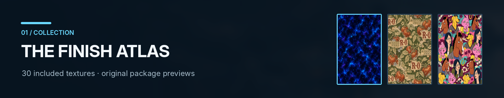

Azimuth includes **30 actual texture finishes**. Each has a stable catalog identity, a DayZ `.paa` runtime texture, and a real control-panel preview. The images below are **the exact preview PNG files packaged with Azimuth**; they are not AI re-creations, conceptual skins or photographs of finished in-game models.

### What can receive a finish?

| Item group | Eligible examples | Important constraint |
|:---|:---|:---|
| **Weapons** | Compatible rifles, handguns, shotguns, and other firearms using recognized body selections. | The model must expose a safe texture selection. |
| **Attachments** | Compatible magazines, stocks, handguards, bayonets, suppressors and selected fitted parts. | Optics, glass, reticles and unrecognized surfaces are protected. |
| **Melee equipment** | Items that expose supported paintable melee surface selections. | Native melee classification can include some ordinary held objects. |
| **Wearable gear** | Supported backpacks, helmets and clothing, including defined ground/worn selections. | Protected faces, visors and cutouts remain untouched. |
| **Vehicles** | Compatible mapped body areas and supported attached panels. | Partial support is common; whole-body coverage is not guaranteed. |

### Selection and probability

The **Skins / Camos** page lets the player check any subset of the 30 finishes. Only the checked finishes enter future random decisions. **Weapons and gear share one saved percentage; vehicles have their own separate percentage.** For example, a 20% vehicle chance is evaluated for eligible vehicles, not 20% of every car's body panels. A 100% chance still cannot paint a model with no safe exposed selection.

The random system derives results from an entity's **persistent ID** and stable finish catalog IDs. With unchanged selections and percentages, the same persistent item receives the same cosmetic decision when loaded again. Changes to the active selection or chance can change an existing item's result after configuration is applied. This is a visual system: **it does not alter recoil, damage, ammunition, cargo, fuel, driving physics or loot spawn rates**.

### Render safety and restoration

Azimuth uses a selection-based approach rather than blindly painting texture index zero. It keeps track of original surface textures, avoids recognized windows, optics, glass, cutout textures and other protected faces, and uses bounded retries for delayed or reset texture assignments. Fitted panels follow an eligible parent vehicle's finish and restore their original owned appearance when detached. An unrelated texture override from another system is not intentionally overwritten during restoration.

These protections are grounded in the supplied code and configuration checks. Actual rendering is still affected by an object's UV layout, the game's materials, lighting, damage state and third-party model design.

### Two kinds of rifle cosmetics

The project also contains **60 dedicated fixed-skin M4A1 and AKM variants** (30 finishes per rifle family). Those authored weapon classes are not the same as randomly applied colors on ordinary saved items. Existing fixed-skin classes remain available even when a finish is unchecked so previously created equipment is not accidentally orphaned; checkboxes govern **new random selections**.


## The 30-finish atlas

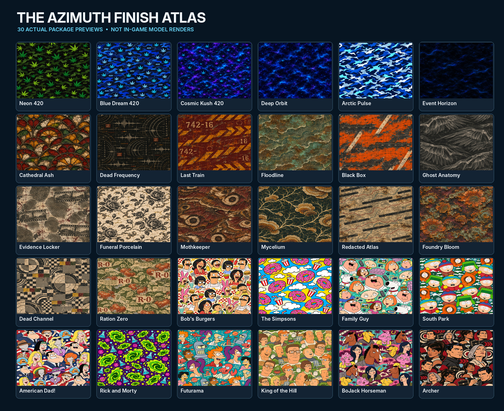

**Every image below comes directly from `Custom/GunSkins/Previews` in the uploaded R23 package.** Click any sample for the original supplied PNG. These are flat material previews, **not** a claim that the design is visible over an entire weapon or vehicle in DayZ.


### 01 — Blue, space and 420 originals

Six original finishes combining saturated blues, cosmic textures and 420 motifs.

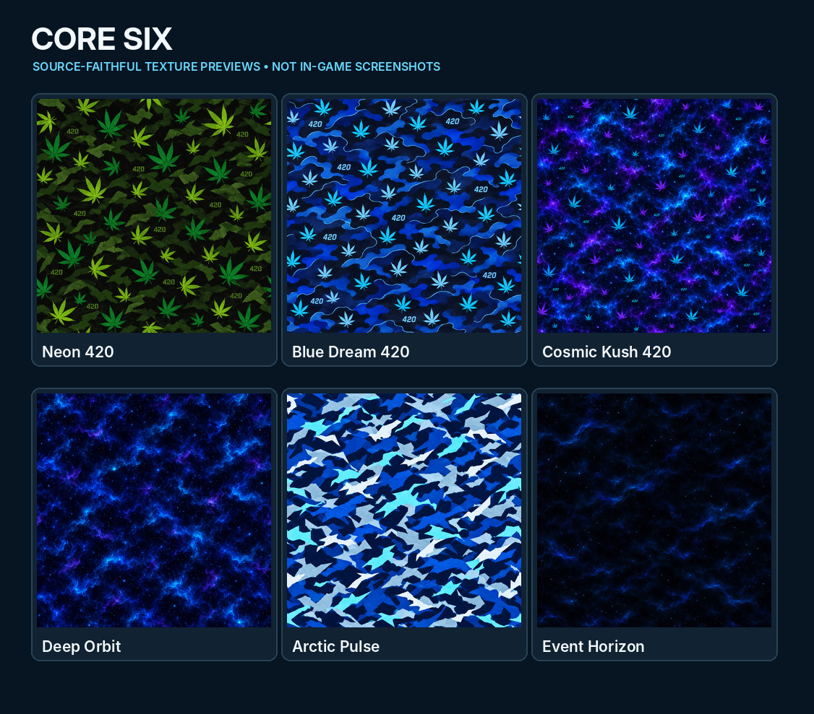


<table>
<tr>
<td align="center" width="33%"><a href="assets/github/finishes/neon420.png">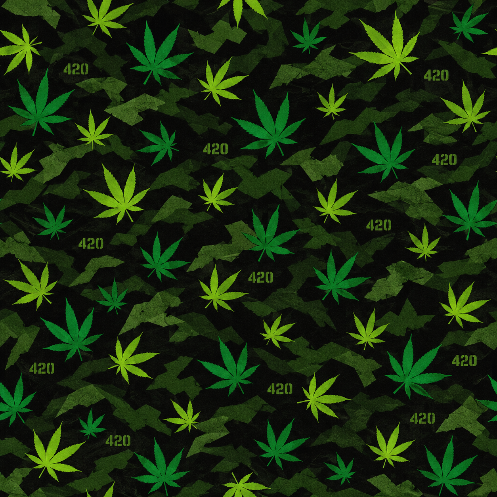</a><br/><strong>Neon 420</strong><br/><sub>CATALOG 01 · PNG SOURCE PREVIEW</sub></td>
<td align="center" width="33%"><a href="assets/github/finishes/bluedream420.png">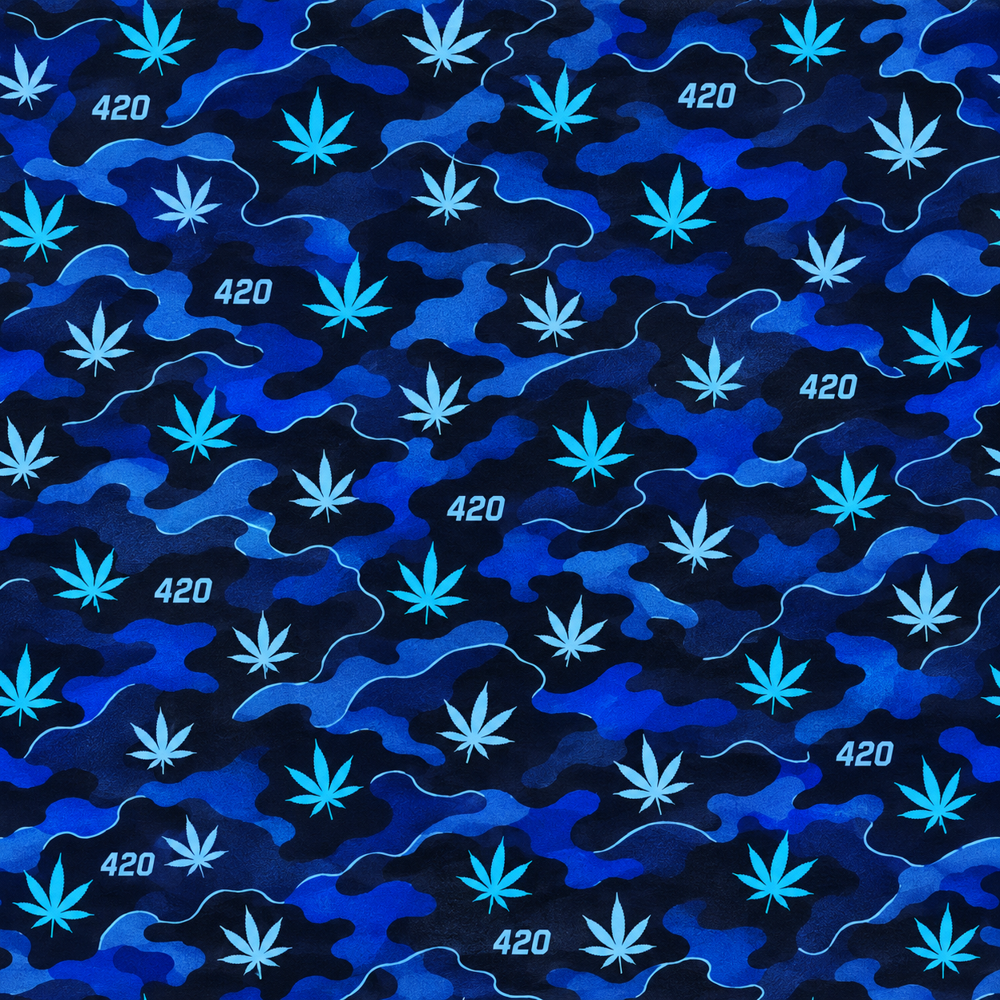</a><br/><strong>Blue Dream 420</strong><br/><sub>CATALOG 02 · PNG SOURCE PREVIEW</sub></td>
<td align="center" width="33%"><a href="assets/github/finishes/cosmickush420.png"></a><br/><strong>Cosmic Kush 420</strong><br/><sub>CATALOG 03 · PNG SOURCE PREVIEW</sub></td>
</tr>
</table>


<table>
<tr>
<td align="center" width="33%"><a href="assets/github/finishes/deeporbit.png"></a><br/><strong>Deep Orbit</strong><br/><sub>CATALOG 04 · PNG SOURCE PREVIEW</sub></td>
<td align="center" width="33%"><a href="assets/github/finishes/arcticpulse.png">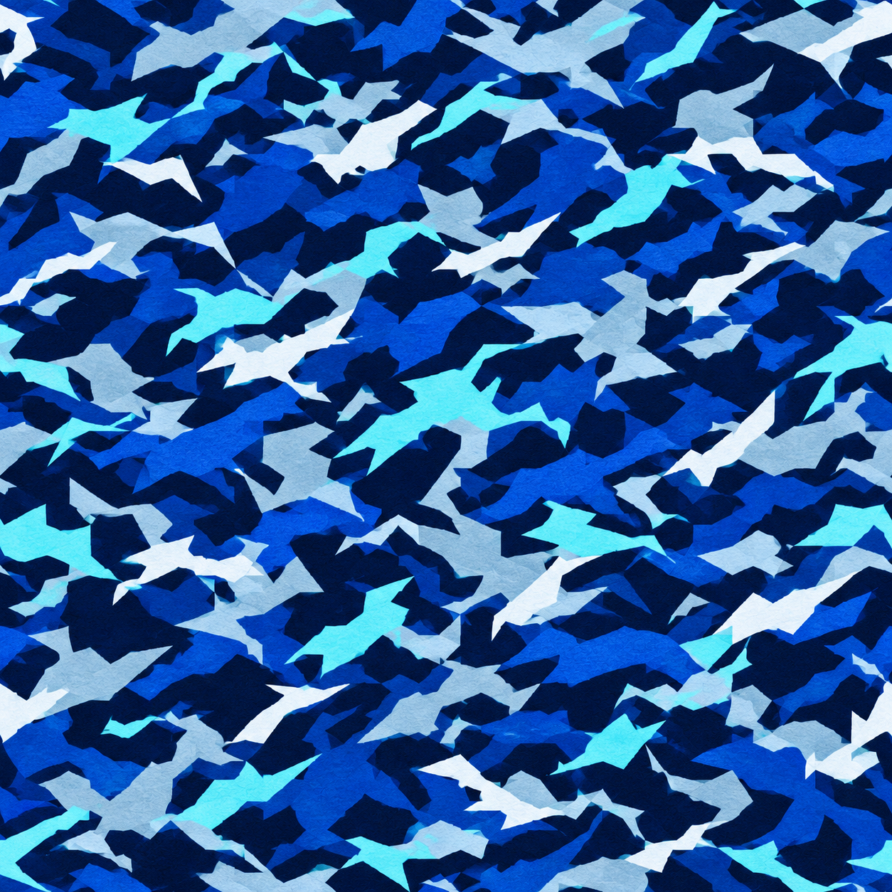</a><br/><strong>Arctic Pulse</strong><br/><sub>CATALOG 05 · PNG SOURCE PREVIEW</sub></td>
<td align="center" width="33%"><a href="assets/github/finishes/eventhorizon.png"></a><br/><strong>Event Horizon</strong><br/><sub>CATALOG 06 · PNG SOURCE PREVIEW</sub></td>
</tr>
</table>


| Finish | Original visual design |
|:---|:---|
| **Neon 420** | Vivid green cannabis motifs over a shadow-black field, with small 420 accents. |
| **Blue Dream 420** | Electric-blue camouflage with bright blue cannabis leaves and repeating 420 details. |
| **Cosmic Kush 420** | Violet cosmic nebula and luminous blue botanical motifs with subtle 420 details. |
| **Deep Orbit** | Dark blue, electric nebula-like energy over a midnight-black background. |
| **Arctic Pulse** | High-contrast icy-blue, navy and white angular camouflage. |
| **Event Horizon** | Nearly black, deep-navy cosmic clouds with restrained electric-blue highlights. |


### 02 — Survival original collection

Fourteen weathered, archival, industrial, biological and post-apocalyptic designs.

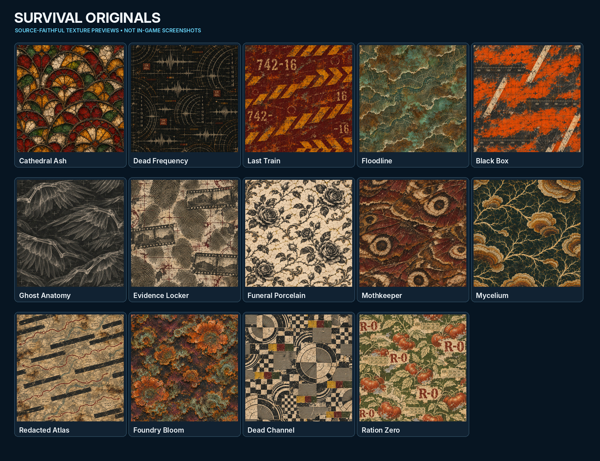


<table>
<tr>
<td align="center" width="33%"><a href="assets/github/finishes/cathedralash.png">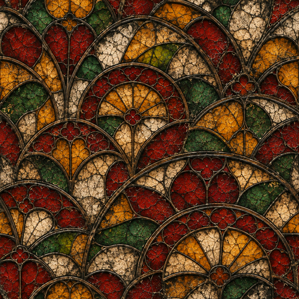</a><br/><strong>Cathedral Ash</strong><br/><sub>CATALOG 07 · PNG SOURCE PREVIEW</sub></td>
<td align="center" width="33%"><a href="assets/github/finishes/deadfrequency.png">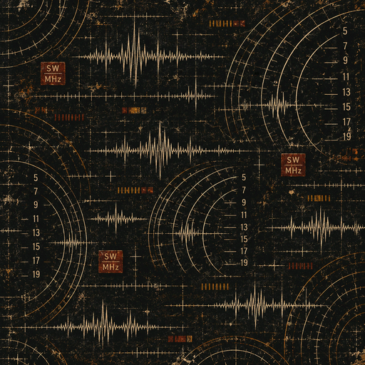</a><br/><strong>Dead Frequency</strong><br/><sub>CATALOG 08 · PNG SOURCE PREVIEW</sub></td>
<td align="center" width="33%"><a href="assets/github/finishes/lasttrain.png">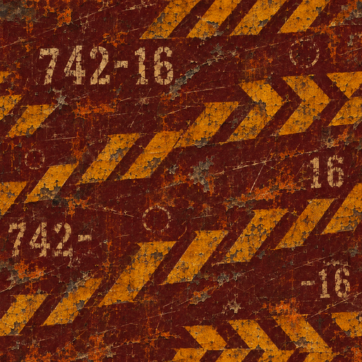</a><br/><strong>Last Train</strong><br/><sub>CATALOG 09 · PNG SOURCE PREVIEW</sub></td>
</tr>
</table>


<table>
<tr>
<td align="center" width="33%"><a href="assets/github/finishes/floodline.png">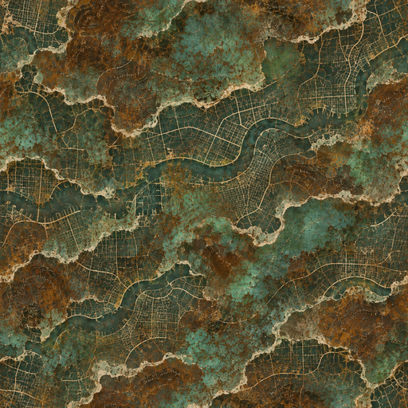</a><br/><strong>Floodline</strong><br/><sub>CATALOG 10 · PNG SOURCE PREVIEW</sub></td>
<td align="center" width="33%"><a href="assets/github/finishes/blackbox.png">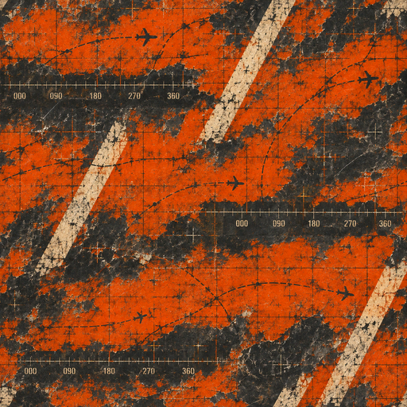</a><br/><strong>Black Box</strong><br/><sub>CATALOG 11 · PNG SOURCE PREVIEW</sub></td>
<td align="center" width="33%"><a href="assets/github/finishes/ghostanatomy.png">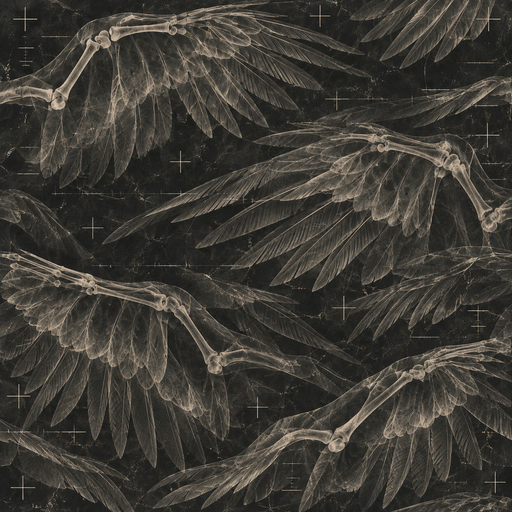</a><br/><strong>Ghost Anatomy</strong><br/><sub>CATALOG 12 · PNG SOURCE PREVIEW</sub></td>
</tr>
</table>


<table>
<tr>
<td align="center" width="33%"><a href="assets/github/finishes/evidencelocker.png"></a><br/><strong>Evidence Locker</strong><br/><sub>CATALOG 13 · PNG SOURCE PREVIEW</sub></td>
<td align="center" width="33%"><a href="assets/github/finishes/funeralporcelain.png">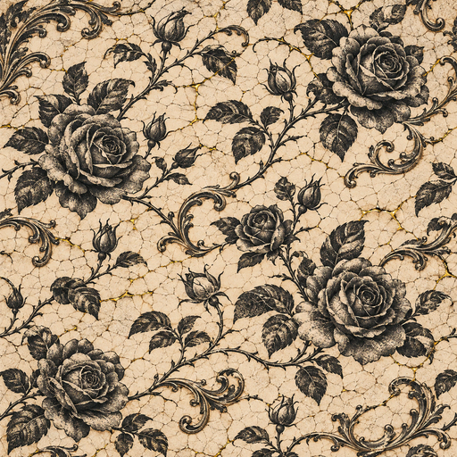</a><br/><strong>Funeral Porcelain</strong><br/><sub>CATALOG 14 · PNG SOURCE PREVIEW</sub></td>
<td align="center" width="33%"><a href="assets/github/finishes/mothkeeper.png"></a><br/><strong>Mothkeeper</strong><br/><sub>CATALOG 15 · PNG SOURCE PREVIEW</sub></td>
</tr>
</table>


<table>
<tr>
<td align="center" width="33%"><a href="assets/github/finishes/mycelium.png"></a><br/><strong>Mycelium</strong><br/><sub>CATALOG 16 · PNG SOURCE PREVIEW</sub></td>
<td align="center" width="33%"><a href="assets/github/finishes/redactedatlas.png">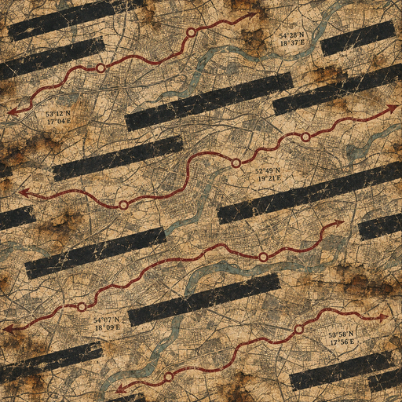</a><br/><strong>Redacted Atlas</strong><br/><sub>CATALOG 17 · PNG SOURCE PREVIEW</sub></td>
<td align="center" width="33%"><a href="assets/github/finishes/foundrybloom.png">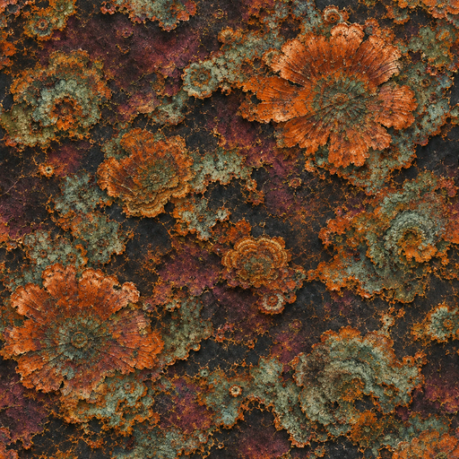</a><br/><strong>Foundry Bloom</strong><br/><sub>CATALOG 18 · PNG SOURCE PREVIEW</sub></td>
</tr>
</table>


<table>
<tr>
<td align="center" width="33%"><a href="assets/github/finishes/deadchannel.png">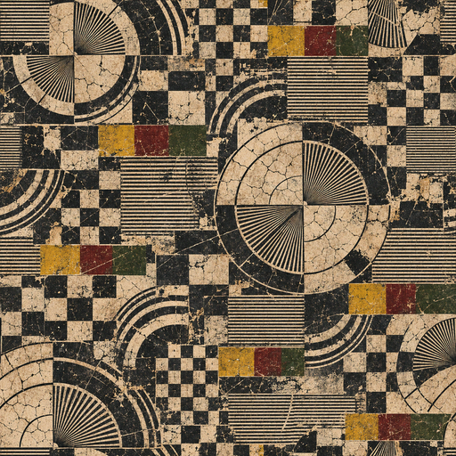</a><br/><strong>Dead Channel</strong><br/><sub>CATALOG 19 · PNG SOURCE PREVIEW</sub></td>
<td align="center" width="33%"><a href="assets/github/finishes/rationzero.png">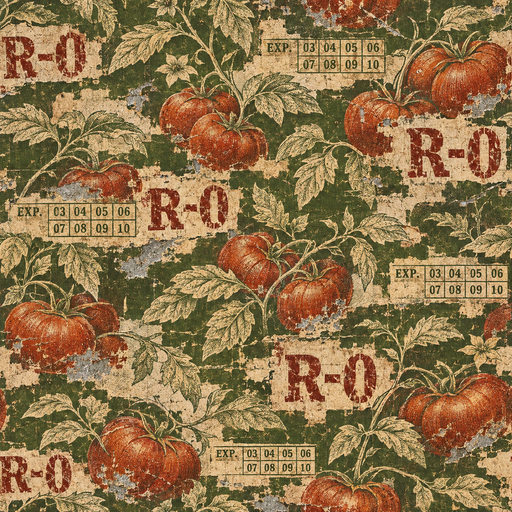</a><br/><strong>Ration Zero</strong><br/><sub>CATALOG 20 · PNG SOURCE PREVIEW</sub></td>
<td width="33%"></td>
</tr>
</table>


| Finish | Original visual design |
|:---|:---|
| **Cathedral Ash** | Fractured garnet, amber and emerald church glass under soot and worn steel. |
| **Dead Frequency** | Ivory shortwave waveforms and tuning arcs on battered charcoal radio lacquer. |
| **Last Train** | Oxblood railcar paint, aged mustard chevrons, carriage marks and rust trails. |
| **Floodline** | Verdigris copper, pale flood marks and a drowned street map beneath mineral stains. |
| **Black Box** | Scorched rescue orange, recorder grids and worn emergency markings over dark metal. |
| **Ghost Anatomy** | Ivory bird-wing radiographs and delicate registration marks on smoke-black paint. |
| **Evidence Locker** | Archival ivory, black fingerprints, burgundy evidence grids and contact-sheet fragments. |
| **Funeral Porcelain** | Black cemetery roses, cracked warm-white enamel and thin tarnished-gold repair lines. |
| **Mothkeeper** | Dusk-moth eyespots, fine wing veins and dusty specimen markings in tobacco and burgundy. |
| **Mycelium** | Ivory fungal filaments and amber spore-ring impressions across blackened forest green. |
| **Redacted Atlas** | An aged evacuation map with matte-black redactions and an oxblood escape route. |
| **Foundry Bloom** | Copper-orange mineral rosettes, verdigris and heat-stained iron resembling corrosion flowers. |
| **Dead Channel** | A fractured emergency-broadcast test card with worn calibration circles and scan lines. |
| **Ration Zero** | Pea-green and cream cannery art, faded tomato lithography and scratched ration markings. |


### 03 — Adult animation collection

Ten themed finishes based on recognizable animated-series characters and motifs.

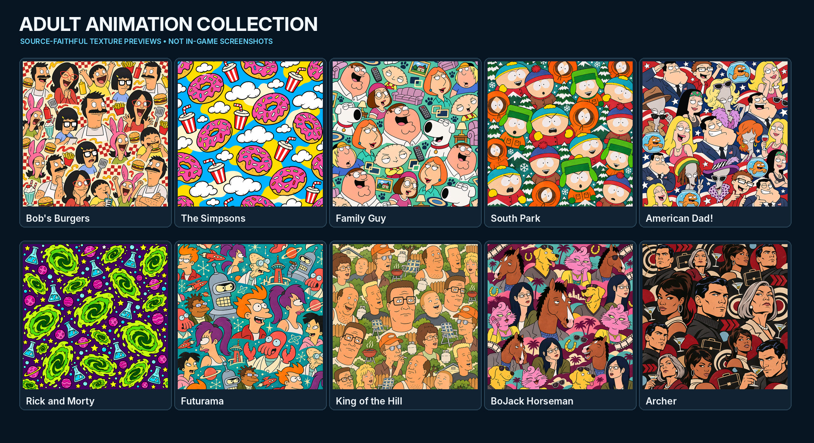


<table>
<tr>
<td align="center" width="33%"><a href="assets/github/finishes/bobsburgers.png"></a><br/><strong>Bob's Burgers</strong><br/><sub>CATALOG 21 · PNG SOURCE PREVIEW</sub></td>
<td align="center" width="33%"><a href="assets/github/finishes/thesimpsons.png"></a><br/><strong>The Simpsons</strong><br/><sub>CATALOG 22 · PNG SOURCE PREVIEW</sub></td>
<td align="center" width="33%"><a href="assets/github/finishes/familyguy.png"></a><br/><strong>Family Guy</strong><br/><sub>CATALOG 23 · PNG SOURCE PREVIEW</sub></td>
</tr>
</table>


<table>
<tr>
<td align="center" width="33%"><a href="assets/github/finishes/southpark.png"></a><br/><strong>South Park</strong><br/><sub>CATALOG 24 · PNG SOURCE PREVIEW</sub></td>
<td align="center" width="33%"><a href="assets/github/finishes/americandad.png"></a><br/><strong>American Dad!</strong><br/><sub>CATALOG 25 · PNG SOURCE PREVIEW</sub></td>
<td align="center" width="33%"><a href="assets/github/finishes/rickandmorty.png"></a><br/><strong>Rick and Morty</strong><br/><sub>CATALOG 26 · PNG SOURCE PREVIEW</sub></td>
</tr>
</table>


<table>
<tr>
<td align="center" width="33%"><a href="assets/github/finishes/futurama.png"></a><br/><strong>Futurama</strong><br/><sub>CATALOG 27 · PNG SOURCE PREVIEW</sub></td>
<td align="center" width="33%"><a href="assets/github/finishes/kingofthehill.png">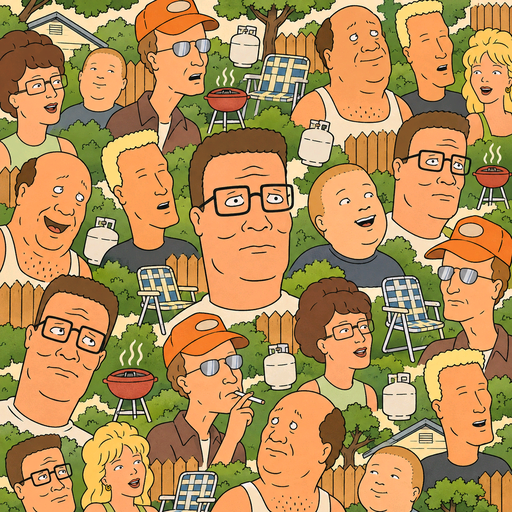</a><br/><strong>King of the Hill</strong><br/><sub>CATALOG 28 · PNG SOURCE PREVIEW</sub></td>
<td align="center" width="33%"><a href="assets/github/finishes/bojackhorseman.png"></a><br/><strong>BoJack Horseman</strong><br/><sub>CATALOG 29 · PNG SOURCE PREVIEW</sub></td>
</tr>
</table>


<table>
<tr>
<td align="center" width="33%"><a href="assets/github/finishes/archer.png">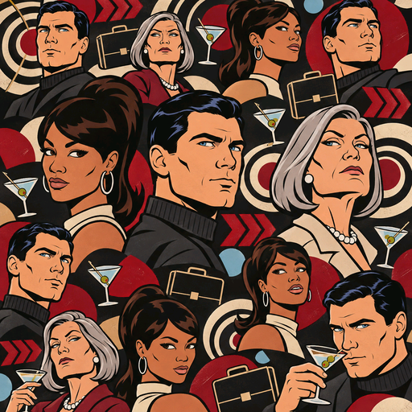</a><br/><strong>Archer</strong><br/><sub>CATALOG 30 · PNG SOURCE PREVIEW</sub></td>
<td width="33%"></td>
<td width="33%"></td>
</tr>
</table>


| Finish | Original visual design |
|:---|:---|
| **Bob's Burgers** | Belcher-family diner art in ketchup red, mustard yellow and warm cream. |
| **The Simpsons** | Pink sprinkled donuts, white clouds and soda cups on a sunny cartoon-blue sky; an object-motif design. |
| **Family Guy** | Quahog-family cartoon art with cream, green, red and navy accents. |
| **South Park** | Cut-paper town characters, snowy backgrounds and boldly colored winter coats. |
| **American Dad!** | Smith-household cartoon art with red, white, blue and gray-alien accents. |
| **Rick and Morty** | Acid-green portal swirls, tiny planets and laboratory flasks on deep purple; an object-motif design. |
| **Futurama** | Fry, Leela, Bender and the crew with retro rockets on a turquoise cartoon backdrop. |
| **King of the Hill** | Hank and the Arlen neighbors with propane tanks, backyard grills and warm earth tones. |
| **BoJack Horseman** | Hollywood animal-character art in faded pink, teal, mustard and purple. |
| **Archer** | Spy-comic character art with tailored charcoal, burgundy, cream and orange accents. |


### Using the collection

The finish names above refer to a **shared palette**, not 30 different separate mods. The same selected collection is evaluated for eligible firearms, attachments, clothing, equipment and supported vehicle surfaces. The gallery shows every included artwork once, instead of repeating identical flat images and pretending to have verified 30 screenshots per vehicle.

To make a visible vehicle showcase in a running game, start with a mapped vehicle, set vehicle wrap chance to 100%, select a few highly distinguishable finishes, and check the actual surface in DayZ. The **same source texture** can look different on an M4A1, a backpack, a car hood or a boat sail because each model's texture coordinates are different.


## Vehicle-wrap coverage and limits

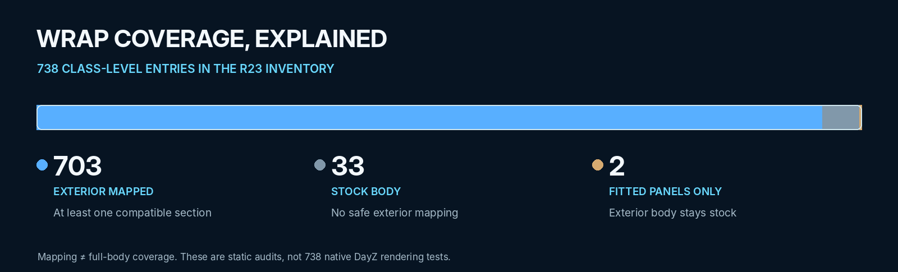

The supplied inventory lists **738 public vehicle variants** examined across supported transport classes and source models. They break down into **703 with at least one mapped exterior selection**, **33 that retain a stock body**, and **2 with eligible fitted panels only**. This is a configuration/model coverage audit, **not 738 complete in-game wrap tests**.

| Result | Count | Meaning in practice |
|:---|---:|:---|
| Exterior mapped | **703** | At least one eligible outside selection can be assigned a finish. It may cover only part of the model. |
| Stock body | **33** | The body intentionally retains original appearance because safe independent paint selections are unavailable. |
| Fitted panels only | **2** | The body remains stock while mapped detachable panels may support wraps. |
| **Total audited** | **738** | Public classes and variants inventoried in this release. |

### Notable examples of partial coverage

| Vehicle or family | Verified configuration boundary |
|:---|:---|
| **Airship** | Isolated left/right banners can be mapped; the main hull remains stock. |
| **Galleon** | Sail selections are mapped; comprehensive hull coverage is **not** claimed. |
| **Vodnik** | Rear exterior module mapping; mixed cabin sections retain their stock material. |
| **Gaz69** | Supported rear, fender and hood surfaces; mixed front/interior/chassis surfaces stay stock. |
| **Humvee** | Multi-material door exteriors still require material-specific work; texture readback alone cannot establish visible wrapping. |
| **KA60** | Mapped fitted panels only; mixed body, glass and interior selections are protected. |
| **LM aircraft** | Nine of the 12 listed LM variants have safe exterior mappings; Cessna180, Catalina and Patty Wagon keep stock bodies. |
| **Horses** | Living animal bodies are not part of the vehicle-wrap mechanism. |

The stock-appearance list also includes specified RTrzr, Zodiac, jet ski, recreational watercraft, camper/RV, helicopter and bicycle models. Those vehicles can still be used as transport; a missing paint selection does not make them unavailable to drive or spawn through their actual systems.

**Important:** A model with an exterior mapping may still appear partly stock or visually different because of material shaders, shared texture atlases and damaged states. The R23 model audit inspected **145 supplied models** and **2,985 compiled section/face comparisons**. Those checks verify structural eligibility, **not native DayZ screenshots for every class**. The existing Gunter screenshot was the reported in-game visual evidence; that screenshot was not included in this uploaded ZIP, so this README does not display a substitute image.

Full class-level evidence: [Vehicle wrap coverage](Docs/Guides/VEHICLE_WRAP_COVERAGE.txt) · [738 variant index](Docs/Guides/VEHICLE_VARIANTS.csv) · [Wrap guide](Docs/Guides/VEHICLE_WRAPS_GUIDE.txt).


## Land, sea and air transport

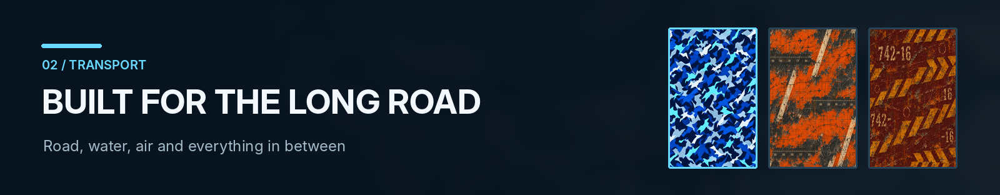

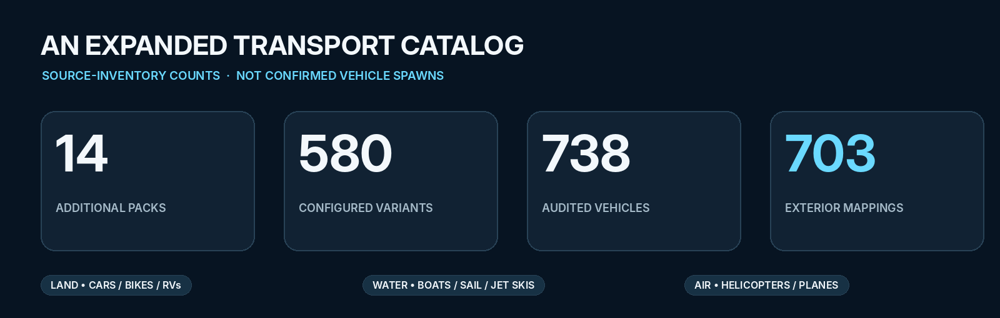

Avalon's transport layer extends beyond the usual cars and trucks. It coordinates native DayZ and Expansion vehicles alongside publisher-managed packs. **Vehicles retain their own parts, fuel, maintenance requirements, control schemes and physics**; Azimuth integrates eligible vehicle types and world spawn routes rather than making every vehicle behave alike.

### Ways to travel

| Environment | Transport included across the supported integrations |
|:---|:---|
| **Road and utility** | Passenger cars, SUVs, pickups, trucks, buses, tractors, military transport and selected amphibious vehicles. |
| **Small and recreational** | Bicycles, motorcycles, mopeds, Vespas, ATVs, golf carts, go-karts, trolley karts and camper/RV models. |
| **Water** | Motorboats, inflatables, jet skis, yachts, houseboats, sailboats, catamarans and galleons. |
| **Air** | Helicopters, gyrocopters, the An-2 and configured LM landplanes and seaplanes. |
| **Other** | Rideable horses and an airship subject to their installed publisher content. |

### All 14 additional configured Workshop packs

The figures below count configured **variants**, including color and body variations. They do not mean 580 independent vehicle designs, simultaneous spawns, or owned vehicles in the saved world.

| Publisher / pack name | Configured variants |
|:---|---:|
| MBM Go-Kart | 15 |
| GolfCart | 6 |
| CrSk Vespa 125 Primavera | 44 |
| Techs ATV | 36 |
| RaG Vehicle Pack | 38 |
| MaharlikaPH Cars | 21 |
| 4KBOSSK Vehicle Package | 304 |
| MaharlikaPH Boats | 25 |
| Arma 2 Helicopters Remastered | 65 |
| Trolley Kart UPDATED | 5 |
| Arma Bicycles | 2 |
| LMs Planes | 12 |
| MaharlikaPH Galleon | 6 |
| Airship-Survive | 1 |
| **TOTAL** | **580** |

### Integration details

**Workshop delivery:** Supported packs are configured for the client and server after Steam has installed the required publisher downloads and dependencies. Third-party PBOs remain publisher-owned. **Attachment compatibility:** the manager uses inspected part and slot definitions; optional unavailable parts are omitted from new recipes rather than fabricated. **Land placement:** authored Avalon event pools provide normal road and utility spawn possibilities under economy caps. **Water/air placement:** appropriate dedicated points and the bounded automatic survey supply safer positions for larger craft or separate aircraft. **LM Planes:** landplanes use approved airport anchors, while seaplanes use large-water routes.

Actual spawn frequency depends on the running central economy, allowed events, map locations, safe clearance and saved world state. A configured variant is not guaranteed to appear in a particular session.

Detailed integration notes: [Transportation guide](Docs/Guides/TRANSPORTATION_GUIDE.txt) · [Vehicle class index](Docs/Guides/VEHICLE_VARIANTS.csv).


## Inspection, photo mode and showcases

Azimuth includes creative tools intended for **showing off real owned equipment** rather than altering combat or world simulation. Both controls are registered through the custom DayZ input configuration; they can be rebound through DayZ's Controls interface.

### First-person weapon inspection

Press **`I`** to use the custom weapon-inspection action with the held weapon. The purpose is to view a finish and the equipped weapon more clearly through the implemented animation path. Actual animation support still depends on the installed game and compatible weapon class.

### Screenshot camera

Press **`P`** to enter or exit the photo camera. The camera operates independently of character walking, hides the HUD, permits close-up views around the character and stays within an approximately **20-meter** radius. The game world continues while the camera is active; it is not a time-freeze or invulnerability feature.

| Control | Photo camera action |
|:---|:---|
| **P** | Enter or exit photo camera. |
| **W / A / S / D** | Move horizontally. |
| **Q / E** | Move down / up. |
| **Mouse** | Rotate viewpoint. |
| **Mouse wheel** | Adjust zoom. |
| **Left Shift** | Faster camera movement. |
| **Left Ctrl** | Slower precision movement. |
| **F12** | Default Steam screenshot shortcut; can differ with Steam bindings. |

`P` changes the camera state and **does not** automatically save an image. Any finished in-game showcase screenshots need to be captured on a running DayZ installation; this repository gallery intentionally uses authentic texture previews instead of manufacturing gameplay pictures.

### Optional equipment and one-time vehicles

The Skins / Camos controls also include optional weapon showcase equipment, a historical Gunter delivery, and a **one-time MBM go-kart** showcase. The go-kart request uses a safe nearby placement search on clear outdoor ground. Its setup uses the publisher's battery, spark plug and four wheels. An optional flashlight is intentionally excluded because of a publisher headlight-key conflict.

Receipts are **separate and durable** for the Gunter and go-kart; rejoining, restarting or reapplying a package does not repeatedly award the same vehicle. A missing required class or unsafe nearby placement does not count as successful delivery. For everyday survival, the optional showcase can be disabled after testing.


## Graphics and personal preferences

Azimuth provides client profile selection and a choice of **Avalon Visuals**, **FPS preset**, **Balanced graphics**, and **Your DayZ settings** modes. The manager stores the choice and supports restoring the previous DayZ graphics configuration. Optional color grading is separate from basic server operation.

Avalon's supported configuration ceilings are **3,000 meters for objects** and **5,000 meters for terrain**. These are **configuration ceilings**, not guaranteed visible distance or frame rate. Actual visibility, lighting and performance depend on client hardware, DayZ settings, models, draw distance behavior and the live world. Selecting a visual preset can cost performance; the FPS preset trades some visual ambition for responsiveness.


## Persistence, backups and recovery


Azimuth separates its application code from the data that makes a world persistent. Important state includes **saved characters, bases, world profiles, cosmetic choices and percentages, existing vehicles, showcase delivery receipts, installed/generated content references, and backup archives**.

### What happens on Stop

**Stop** requests a clean server shutdown and a final backup. The manager waits for evidence of shutdown and archive completion. If shutdown cannot be confirmed, it reports a delayed or unverified backup rather than falsely marking it as successful. Backup and activity views expose the relevant status.

### Restoring a world

A restore starts with the server **stopped**, validates the selected archive and its world context, creates a safety copy when appropriate, and replaces the documented restored state. The server is **left stopped for review** after restoration. Restore is intentionally separate from a routine Play action because overwriting a world is consequential.

### Updating without a wipe

Replacing Azimuth's packaged program files is not the same as deleting a server installation. Existing `Worlds`, `Config`, `Mods`, and `Backups` directories must be retained. Cosmetic changes are designed to respect previously saved IDs and finished showcase receipts. Backups should still be verified before changing production files.


## Requirements and installation

| Component | Requirement |
|:---|:---|
| **Operating system** | Windows 10 or Windows 11, **64-bit**. |
| **Python runtime** | 64-bit Python **3.10 or newer**, including Tcl/Tk for the desktop interface. |
| **Steam** | Working Steam installation for DayZ, DayZ Server, DayZ Tools and subscribed Workshop content. |
| **Game** | DayZ PC plus a matching DayZ Server version. |
| **Build and signing tools** | DayZ Tools for the generated custom mod workflow when regeneration is required. |
| **Workshop dependencies** | Avalon and the original installed publisher mods needed for selected integrations. |
| **Machine resources** | Adequate CPU, RAM, storage and bandwidth; simultaneously running the client and server adds load. |

**Platform scope:** This is a locally hosted **PC** DayZ project; hosting a private DayZ world for a console is **not** offered or verified by this package.


## Getting started

### First installation

1. Install the required 64-bit Python runtime, Steam, DayZ and DayZ Server. Make DayZ Tools available for custom addon preparation.
2. Extract **this complete combined ZIP** to a permanent folder. Its single top-level folder is `Azimuth`; that folder contains both `START_SERVER.bat` and `README.md`.
3. Open **`Azimuth/START_SERVER.bat`**. This starts the desktop manager; it is not a separate installer or updater.
4. Open **Workshop** and review missing or pending downloads and their required dependencies. Let Steam finish preparing the original publisher content.
5. Select **Avalon**; review graphics, survival preferences and desired **Skins / Camos** finishes.
6. Select **Play Avalon**. The manager checks versions and dependencies, prepares eligible custom integrations and coordinates the game and local server launch.
7. Review **Activity** if a requirement is missing, a server startup fails or a first-run world preparation has not yet finished.

### Updating an existing installation

1. In the old manager, **Stop Avalon** and wait for shutdown to complete. Confirm a current archive under **Backups** (or use **Back up now**).
2. Exit Azimuth and DayZ so no running process retains the old files.
3. Extract the complete replacement `Azimuth` folder into the **same installation location**, replacing packaged application files.
4. **Do not delete** or wipe `Worlds`, `Config`, `Mods` or `Backups`. Preserve existing user data and any custom files that are not explicitly replaced.
5. Confirm that the launcher path is **`Azimuth/START_SERVER.bat`**, not a nested `Azimuth/Azimuth/START_SERVER.bat` path.
6. Start the manager and use **Play Avalon** so new generated sources can be rebuilt and signed through the existing Windows workflow when necessary.

### Changing finishes safely

Stop Avalon, close DayZ, select desired artwork in **Skins / Camos**, adjust gear and/or vehicle chance independently, **Save changes**, and launch through Azimuth. A new choice may change the resulting finish on existing randomly painted items. Previously installed fixed-skin rifle classes remain available even when their artwork is no longer checked for random assignment.

For package-specific setup, see [Start Here](Docs/START_HERE.md). **This combined release contains the runnable Azimuth application, its custom addon sources, the GitHub README, preview artwork, and the latest economy/map audit evidence in one `Azimuth` folder.** DayZ, Steam, DayZ Tools and third-party Workshop downloads are external prerequisites and are not redistributed here.


## File layout

This is the **actual combined release layout**: runnable Python sources, custom addon sources, GitHub artwork and audit documents share one repository-ready `Azimuth` root. Persistent runtime folders may be created or populated on your PC after first launch.

```text
Azimuth/
├── README.md                        # Complete GitHub project presentation
├── START_SERVER.bat                 # Windows launcher
├── assets/github/                   # GitHub visuals and all finish previews
├── Engine/
│   ├── launch.py                   # Application entry and checks
│   ├── Assets/                     # Manager artwork
│   └── azimuth_app/
│       ├── core/                   # Lifecycles, worlds, backups, migration
│       ├── ui/                     # Window pages and desktop theme
│       ├── client/                 # Profiles, Steam, graphics, launch
│       ├── economy/                # Loot balance, publisher economy, XML
│       ├── transport/              # Vehicles, airplanes, horses, surveys
│       ├── world/                  # Atmosphere, building, QOL, airdrops
│       ├── cosmetics/              # Skins, wraps, showcases, photo mode
│       ├── integrations/           # Signing and mod compatibility
│       ├── network/                # Server queries and discovery
│       └── checks/                 # Verification and diagnostics
├── Custom/
│   ├── GunSkins/                   # 30 texture assets and custom addons
│   ├── PhotoMode/                  # In-game photo camera source
│   ├── WeaponInspect/              # Weapon inspect addon source
│   └── Transport/                  # Native, Expansion, Workshop catalog
├── Visuals/                        # Optional native look/color setup
├── WorldSetup/                     # Mission-specific preparation/addons
├── Tools/                          # Optional local checks
├── Docs/
│   ├── Guides/                     # Current setup and playthrough guides
│   ├── Audit/                      # Supplied audit reports/evidence
│   └── Reference/                  # Layout and release notes
├── Worlds/                         # Persistent world data and profiles
├── Config/                         # Persistent application choices
├── Mods/                           # Installed/generated content paths
└── Backups/                        # World backups and safety copies
```

The included `assets/github/finishes/` directory contains all 30 preview PNG files and `assets/github/visuals/` holds the GitHub presentation diagrams. These preview files are separate from the bundled in-game `.paa` textures.


## Avalon Workshop loot economy verification

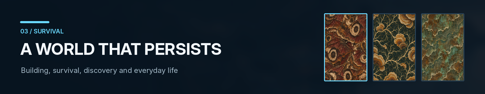

**The goal is a world where normal progression is possible, without giving away every valuable item.** Azimuth registers the active publishers' compatible loot definitions with Avalon's Central Economy, retains the existing survival balance, and protects event-only, crafted, and rare equipment from being made common by mistake.

The **14 November 2026** qualification used the **complete set of 49 uploaded Workshop archives (19.04 GB)**, the original Avalon map mission, and the last working Azimuth R23 application with the successful go-kart-and-parts-crate delivery. The audit reproduces the generated mission economy; it is not a claim of a 49-mod in-game playthrough.

### Audit results

| Verified property | Result | Scope |
|:---|---:|:---|
| Effective CE class definitions | **5,310** | Generated Avalon mission; previously 4,887 |
| Ordinary-loot classes | **1,679** | Previously 1,388; event-only/crafted classes not included |
| Positive publisher-authored natural-loot rows covered | **1,350 / 1,350** | Audited **active** mods with supplied, readable author XML |
| Central Economy extension files | **31 / 31** present | Every referenced generated CE import exists |
| XML layer / contained-loot warnings | **0 / 0** | Offline CE XML and duplicate checks |
| Economy regression checks | **24 passed** | Repeat-start, publisher hashes, previous-file preservation and route checks |
| Original application entries preserved | **304 unchanged** | All earlier baseline files outside two scoped economy integration modules |

**What was improved:** verified RaG BaseItems supplies and kits, BeeHive equipment and honey containers, vehicle repair spares, the wooden-boat engine, plus narrow industrial or building-kit placement repairs where the uploaded publisher definitions did not fit Avalon. The repair retains authored nominal values, crafting and event restrictions, the existing wheel-spare policy, and every earlier custom gameplay feature.

### Checked against Avalon's actual map

These are **real records from the uploaded Avalon mission**, not invented POIs or guessed coordinates.

| Original / regenerated map evidence | Verified count |
|:---|---:|
| Placed building group positions | **4,261** valid coordinate triples |
| Unique active placed building loot groups with valid containers | **387** |
| Natural-resource cluster placement records | **225,015** across the mission's cluster files |
| Event-spawn position records in the generated test mission | **593** finite coordinate pairs |
| Ordinary-loot classes with a full static building/category/usage/tier match | **1,282** |
| Ordinary-loot classes with matching building/category/usage but regional tier still unproven | **320** |
| Remaining ordinary-loot classes without a conclusive static placement match | **77** (64 unmatched + 13 with no explicit item category) |

The **11 original map placement files** were preserved byte-for-byte. The map check also flags pre-existing duplicate author prototypes and treats them as ambiguous; it does **not** alter the map, invent safer locations, or claim runtime precedence is resolved.

**The 77 unresolved static cases are not 77 confirmed broken items.** Many depend on publisher scripts, inventory/container drops, dispatching, or live DayZ rules. The 320 regional-tier cases require native area-flag and live economy confirmation. Airship, large-vessel and selected aircraft locations also require actual terrain clearance, water depth, or physics validation; Azimuth will not fabricate them.

<details>
<summary><strong>Read the complete item-by-item evidence and remaining qualification boundaries</strong></summary>

- [Workshop economy qualification](Docs/Audit/Avalon_Workshop_Economy_Qualification_2026-11-14.md) — additions, provenance, regressions and caveats.
- [Map, placement and event verification](Docs/Audit/Avalon_Map_And_Loot_Verification_2026-11-14.md) — original map-file comparison, placed groups, coordinate checks and static-match detail.
- [All 5,310 effective CE classes (CSV)](Docs/Audit/Avalon_Effective_Item_Loot_Audit_2026-11-14.csv) — per-class route, population, category, usage, tier and confidence.
- [Publisher loot cross-check (CSV)](Docs/Audit/Avalon_Workshop_Publisher_Crosscheck_2026-11-14.csv) — mod-supplied types, author nominal and active-economy coverage.
- [Workshop mod inventory (CSV)](Docs/Audit/Avalon_Workshop_Mod_Coverage_2026-11-14.csv) — active vs. downloaded mods and inspected PBO coverage.
- [77 unresolved static-placement cases (CSV)](Docs/Audit/Avalon_Static_Placement_Unresolved_2026-11-14.csv) — candidates for targeted native evidence, **not** confirmed defects.
- [Machine-readable map verification (JSON)](Docs/Audit/Avalon_Map_And_Loot_Verification_2026-11-14.json).
- [Current economy regression results (JSON)](Docs/Audit/Avalon_Economy_Regression_2026-11-14.json).

</details>

### What was actually tested

The current release ZIP passed integrity verification and its two changed economy source modules match the requalified working source. The verified publisher XML hashes match the files uploaded for this qualification. The economy can regenerate twice without changing the audited output or nominal populations, and the imported classes remain safe if an author updates a source file unexpectedly.

**What remains a live-server question:** DayZ's actual regional loot distribution, ongoing spawn occupancy and despawn cycles, scripted publisher-generated items, interior container capacity, and travel/vehicle physics. An offline file audit can confirm setup and detect many errors; it cannot certify that every possible item will appear in play. See [Verification and known limits](#verification-and-known-limits).

---

## Verification and known limits

The latest **Workshop-verified economy** qualification passed **24 targeted offline checks**, with **zero CE XML/contained-loot warnings**, and the complete application ZIP passed integrity verification. See the [current evidence](Docs/Audit/Avalon_Workshop_Economy_Qualification_2026-11-14.md). These tests are not equivalent to launching and playing every installed mod or vehicle in native Windows DayZ.

The following **historical R23 transport/wrap tests** remain separately documented for their own named earlier release:

| Documented R23 transport/wrap checks | Recorded result |
|:---|---:|
| Repair and regression suite | **235 passing checks** |
| Retained regression suite | **91 passing checks** |
| Combined offline qualification for the named repair package | **326 checks passed** |
| Freshly extracted package check for that same repair | **326 checks passed** |
| Python 3.10-compatible source parsing | **80 Python files parsed** |
| Supplied vehicle model inspection | **145 models examined** |
| Compiled section-to-face comparisons | **2,985 comparisons; zero mismatches** |

**Scope:** These counts are recorded for the **named R23 Transport and Wrap Fixes qualification**, not a new test run of this GitHub documentation, and not a blanket PASS for every later startup correction in the uploaded archive. The supplied audit records separately document various fixes, including startup economy, horse XML, vehicle wrap module boundaries and rendering retries. Their individual counts should not be added to the table as if they were one comprehensive in-game certification.

### Still requiring native confirmation

- A **current native DayZ server run** after installing this exact economy release, with clean server/economy logs. The go-kart + parts-crate delivery had already been confirmed by the user before this scoped economy update; it does not prove every later combination.
- Visible wrap appearance across specific vehicle models/material shaders and all 30 finishes under live UV, lighting, LOD and damage behavior.
- Actual vehicle movement, fuel behavior, flight, boating, client networking and multiplayer conditions.
- Windows toolchain signing/build execution in the user's installed environment.
- The behavior of external Workshop content after publisher updates, changes or missing subscriptions.

**Known limits:** Some vehicles cannot be safely repainted; partial mapping must not be read as whole-body coverage; the Airship hull, several yacht/boat classes and selected aircraft keep stock material; Humvee multi-material doors require separate material treatment. This archive **includes the Azimuth application** and its existing launcher; it does **not** bundle DayZ, publisher Workshop PBOs, or a fully installed game. Native Windows/DayZ runtime behavior remains subject to in-game verification. Do not upload third-party game files without the respective creators' redistribution permissions.

Optional locally supplied checks in the full application: `Tools/VERIFY_PLAYTHROUGH.bat` and `Tools/VERIFY_GUN_SKINS.bat`. The original code and complete verification data must be used for native startup or regression troubleshooting.


## More documentation

| Resource | Details |
|:---|:---|
| [Start Here](Docs/START_HERE.md) | Installation, updates and current R23 package behavior. |
| [Weapon and clothing finishes](Docs/Guides/SKINS_AND_CLOTHING.txt) | Runtime selection, protected surfaces and fixed-skin compatibility. |
| [Vehicle wraps and go-kart showcase](Docs/Guides/VEHICLE_WRAPS_GUIDE.txt) | Vehicle chances, safe placement and delivery receipts. |
| [Vehicle wrap coverage](Docs/Guides/VEHICLE_WRAP_COVERAGE.txt) | Exact limitations and cases with partial or absent mapping. |
| [Vehicle variant index](Docs/Guides/VEHICLE_VARIANTS.csv) | Machine-readable index of all 738 audited public vehicle variants. |
| [Transportation guide](Docs/Guides/TRANSPORTATION_GUIDE.txt) | Integration, Workshop dependencies, spawn logic and route details. |
| [Playthrough audit](Docs/Guides/PLAYTHROUGH_AUDIT.txt) | Current setup and player-facing verification guidance. |
| [Latest economy qualification](Docs/Audit/Avalon_Workshop_Economy_Qualification_2026-11-14.md) | Source-verified loot imports, regression tests and confirmed limitations. |
| [Avalon map verification](Docs/Audit/Avalon_Map_And_Loot_Verification_2026-11-14.md) | Actual map placements, cluster/event geometry and unresolved static matches. |
| [All effective loot classes](Docs/Audit/Avalon_Effective_Item_Loot_Audit_2026-11-14.csv) | Searchable 5,310-class CSV including route, rarity and placement confidence. |
| [Code layout](Docs/Reference/Code_Layout.md) | Architecture overview of the application modules. |


## Credits, dependencies and ownership

**Azimuth is created by Ashton Kenney, known as Astroolean.** The project covers its desktop manager, custom integration and organization, finish selection systems, cosmetic collection packaging, vehicle-wrap logic, creative tools, economy preparation, transport coordination, compatibility work and project documentation.

**DayZ** is developed by **Bohemia Interactive**. **Avalon**, DayZ Expansion, Community Framework, RaG content, Solitude Storage and other integrated Workshop mods remain the work of their respective creators. Azimuth relies on original installed third-party Workshop downloads; their separate licenses, permissions and dependencies continue to apply. No ownership of another creator's original assets or addons is implied.

The adult-animation-inspired finishes feature themes, characters or objects associated with outside media properties. Those references are not official merchandise and do not imply affiliation, licensing, sponsorship or endorsement. **Anyone publicly distributing the project or its artwork should review third-party intellectual-property rights and individual Workshop licenses first.**

---

<div align="center">

<strong>AZIMUTH</strong><p><em>Built because someone wanted a private DayZ world their own way — and decided to make it happen.</em></p><strong>Created by Ashton Kenney · Astroolean</strong>

</div>

